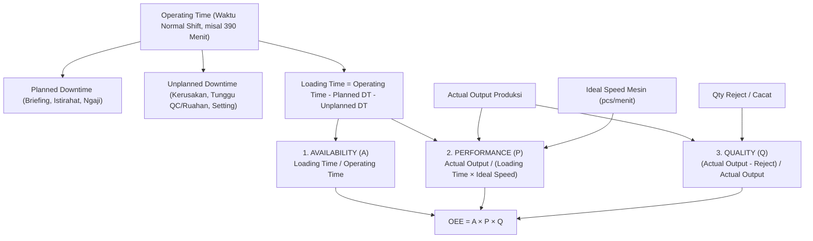
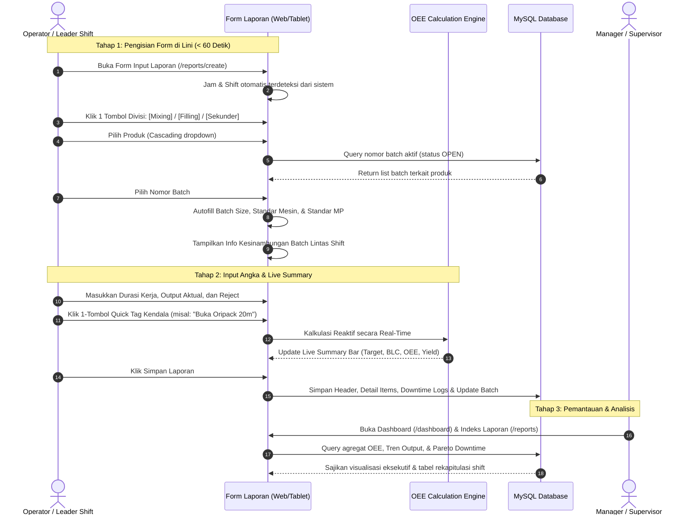
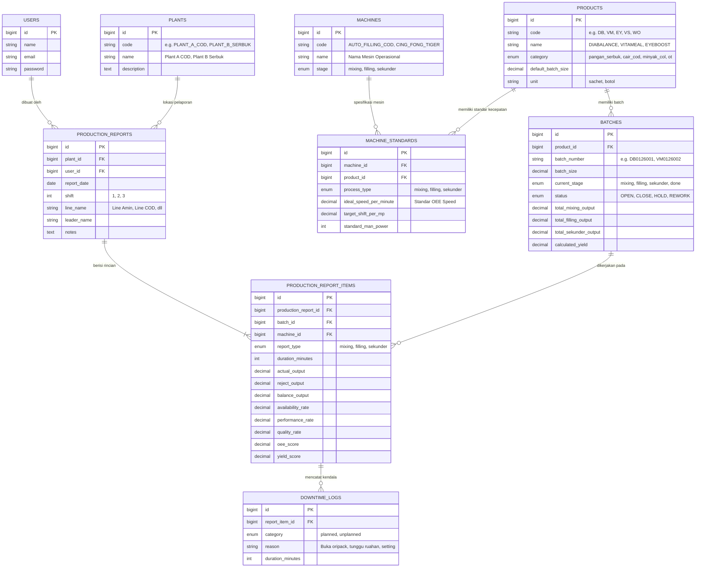

# 🏭 Sistem Management Report Produksi PT Herba Biotech Nusantara (HBT)

Aplikasi web terpadu untuk pencatatan, kalkulasi matematis otomatis (**YIELD & OEE**), pemantauan lini manufaktur, dan pelaporan eksekutif produksi pabrik farmasi/herbal (Plant A COD & COL, Plant B Serbuk Pangan & OT) yang mencakup 3 tahapan proses: **Mixing Primer**, **Filling Primer**, dan **Pengemasan Sekunder**.

---

## 📌 Daftar Isi

1. [Latar Belakang & Tujuan](#-latar-belakang--tujuan)
2. [Tech Stack & Arsitektur Sistem](#-tech-stack--arsitektur-sistem)
3. [Formula Matematis Produksi (Single Source of Truth)](#-formula-matematis-produksi)
   - [Perhitungan YIELD & Balance (BLC)](#1-perhitungan-yield--balance-blc)
   - [Perhitungan OEE (Availability, Performance, Quality)](#2-perhitungan-oee-overall-equipment-effectiveness)
4. [Alur Kerja Sistem (End-to-End System Flow)](#-alur-kerja-sistem-end-to-end-flow)
5. [Design System & Standar UI/UX](#-design-system--standar-uiux)
   - [Filosofi Desain Manufaktur](#filosofi-desain-manufaktur-anti-ai-slop)
   - [Palet Warna ISO/ANSI & Dark/Light Mode](#palet-warna-standar-industri--dual-mode)
   - [Navigasi Collapsible Sidebar](#navigasi-collapsible-sidebar)
   - [Ergonomi Layar Sentuh Tablet (< 60 Detik Input)](#ergonomi-layar-sentuh-tablet-input--60-detik)
   - [Profil Pengguna & Popup Logout](#profil-pengguna--popup-logout-interaktif)
6. [Skema Basis Data (Database Schema & ERD)](#-skema-basis-data-database-schema--erd)
7. [Panduan Instalasi & Menjalankan Proyek](#-panduan-instalasi--menjalankan-proyek)
8. [Struktur Direktori Proyek](#-struktur-direktori-proyek)
9. [Daftar Rute & Endpoint Utama](#-daftar-rute--endpoint-utama)
10. [Peta Dokumentasi Terkait](#-peta-dokumentasi-terkait)

---

## 🎯 Latar Belakang & Tujuan

Sebelum adanya sistem ini, pelaporan operasional pabrik dilakukan secara manual menggunakan file spreadsheet (Excel) terpisah untuk setiap divisi kerja. Hal tersebut menimbulkan kendala:
- **Pencatatan Terfragmentasi**: Data *Mixing*, *Filling*, dan *Sekunder* terisolasi dalam sheet berbeda sehingga sulit melacak status batch utuh.
- **Kesalahan Input Nomor Batch**: Sering terjadi ketidaksamaan penulisan nomor batch atau batch size antar shift.
- **Ketiadaan Standarisasi OEE Harian**: Perhitungan *Overall Equipment Effectiveness* (OEE) belum terintegrasi otomatis saat operator selesai bertugas di lini produksi.
- **Beban Perhitungan Manual**: Operator harus menghitung manual *Balance*, *Loading Time*, dan *Reject*.

**Solusi Sistem**:
Sistem ini mentransformasikan alur kerja manual tersebut menjadi aplikasi berbasis web dengan arsitektur modern yang menjamin **integritas data nomor batch**, **otomatisasi perhitungan OEE dan Yield secara real-time**, serta **kemudahan input operator lini dalam waktu $\le 60$ detik**.

---

## 💻 Tech Stack & Arsitektur Sistem

Aplikasi ini dibangun menggunakan arsitektur *Monolith Modern* berbasis **Laravel 11** dan **Inertia.js v2**:

* **Backend Framework**: [Laravel 11.x](https://laravel.com) (PHP 8.2+)
* **Single-Page Application Bridge**: [Inertia.js v2](https://inertiajs.com) (Server-driven routing tanpa REST API overhead)
* **Frontend Reactive Framework**: [Vue 3](https://vuejs.org) (Composition API `<script setup>`)
* **Styling & Design System**: [Tailwind CSS v3](https://tailwindcss.com) (Dark mode class-based)
* **Iconography**: [Lucide Vue Next](https://lucide.dev) (Konsisten di seluruh komponen aplikasi)
* **Bundler & Build Tool**: [Vite 5](https://vitejs.dev) (Menghasilkan build aset terkompresi)
* **Database**: MySQL 8.x (Terkoneksi via port 8889 / MAMP Socket)
* **Testing Suite**: PHPUnit (10 feature tests, 53 assertions lulus uji)

```mermaid
graph LR
    subgraph Client["Frontend (Browser / Tablet)"]
        Vue["Vue 3 (Inertia Pages)"]
        Tailwind["Tailwind CSS + Dark/Light Mode"]
        Lucide["Lucide Icons"]
    end

    subgraph Bridge["Inertia Protocol"]
        Inertia["Inertia.js v2 Middleware & Props"]
    end

    subgraph Backend["Backend Application (Laravel 11)"]
        Router["Web Routes"]
        Controllers["Controllers (Dashboard, Reports, Batches, Master)"]
        Services["OEE & Yield Business Logic Service"]
        Models["Eloquent Models & Enums"]
    end

    subgraph DB["Database Engine"]
        MySQL[("MySQL 8.x (produksi_hbt)")]
    end

    Client <--> Bridge
    Bridge <--> Backend
    Backend <--> DB
```



---

## 📐 Formula Matematis Produksi

Perhitungan dalam sistem mengacu secara presisi pada formula kalkulasi riil pabrik:

### 1. Perhitungan YIELD & Balance (BLC)

Yield mengukur efisiensi konversi bahan/ruahan menjadi output fisik:

$$\text{Yield (\%)} = \frac{\text{Actual Output}}{\text{Target Batch Size}} \times 100\%$$

$$\text{Balance (BLC)} = \text{Actual Output} - \text{Target Output}$$

*Contoh Riil:*
* Produk: `DIABALANCE`, Batch: `DB0126001`
* Batch Size Rencana = $7.000\text{ sachet}$
* Hasil Akhir Sekunder = $6.932\text{ sachet}$
* $\text{Yield} = \frac{6.932}{7.000} \times 100\% = \mathbf{99{,}03\%}$
* $\text{Balance} = 6.932 - 7.000 = \mathbf{-68\text{ sachet}}$

---

### 2. Perhitungan OEE (Overall Equipment Effectiveness)

OEE mengukur efektivitas menyeluruh pemanfaatan mesin produksi melalui perkalian 3 faktor:

$$\text{OEE} = \text{Availability (A)} \times \text{Performance (P)} \times \text{Quality (Q)}$$



#### A. Availability Rate ($A$)
$$\text{Loading Time} = \text{Operating Time} - (\text{Planned Downtime} + \text{Unplanned Downtime})$$
$$\text{Availability} = \frac{\text{Loading Time}}{\text{Operating Time}}$$

#### B. Performance Rate ($P$)
$$\text{Kapasitas Teoretis} = \text{Loading Time (menit)} \times \text{Kecepatan Desain Mesin (pcs/menit)}$$
$$\text{Performance} = \frac{\text{Actual Output Produksi}}{\text{Kapasitas Teoretis}}$$

*Standar Kecepatan Desain Mesin (Ideal Speed):*
* **Automatic Filling Line (Botol COD)**: $24\text{ botol/menit}$ ($1.440\text{ pcs/jam}$)
* **Tiger Center Seal (Cing Fong Pangan Serbuk)**: $28\text{ sachet/menit}$ ($1.680\text{ pcs/jam}$)
* **Jumbo Center Seal (Cing Fong OT)**: $15\text{ sachet/menit}$ ($900\text{ pcs/jam}$)
* **Mesin Gluing Dusbox (Sekunder)**: $22\text{ dus/menit}$ ($1.320\text{ pcs/jam}$)
* **Semi-Automatic Filling Line**: $12\text{ botol/menit}$ ($720\text{ pcs/jam}$)

#### C. Quality Rate ($Q$)
$$\text{Quality} = \frac{\text{Actual Output} - \text{Qty Reject}}{\text{Actual Output}}$$

---

## 🔄 Alur Kerja Sistem (End-to-End Flow)



---

## 🎨 Design System & Standar UI/UX

Aplikasi dirancang secara khusus untuk lingkungan pabrik manufaktur menggunakan pedoman **Industrial UI/UX**:

### Filosofi Desain Manufaktur ("Anti-AI-Slop")
* **High Information Density**: Memaksimalkan area kerja tanpa ruang kosong berlebihan; tata letak tabel padat data yang terorganisir rapi.
* **Zero Mental Math**: Operator tidak perlu menghitung sisa waktu, target, selisih output, maupun persentase efisiensi secara manual di kertas.
* **Ergonomi Pabrik**: Menggunakan angka dengan font monospace berfitur `tabular-nums` agar digit angka sejajar lurus ke bawah saat diaudit.

### Palet Warna Standar Industri & Dual Mode

| Token Warna | Class Tailwind | Penggunaan di Sistem |
| :--- | :--- | :--- |
| **Industrial Slate** | `bg-slate-50` / `dark:bg-slate-950` | Latar belakang utama anti-pantulan cahaya lampu neon pabrik |
| **Precision Indigo** | `bg-indigo-600` / `text-indigo-400` | Brand aksen, navigasi aktif, dan kartu metrik operasional |
| **Operational Emerald** | `bg-emerald-600` / `text-emerald-400` | Status mesin Online, Batch `OPEN`, tombol simpan, dan metrik di atas target |
| **Amber Caution** | `bg-amber-500` / `text-amber-400` | Peringatan OEE di bawah standar dunia (< 85%), status batch `HOLD` |
| **Rose Alert** | `bg-rose-600` / `text-rose-400` | Downtime mesin kritis, reject tinggi, konfirmasi logout |

* **Toggle Dark / Light Mode**: Tersedia tombol sakelar instan di header atas dan footer profil. Preferensi tema tersimpan permanen pada `localStorage` browser.

### Navigasi Collapsible Sidebar
* **Mode Terbuka (`w-64` / 256px)**:
  * Menampilkan **Logo Resmi HBT** di posisi paling atas.
  * Navigasi dikelompokkan dalam 3 seksi: *Dashboard & Ringkasan*, *Operasional Produksi*, dan *Standar Manufaktur*.
  * Tombol `+ Input Laporan` diberi aksen hijau emerald untuk akses instan.
* **Mode Ramping (`w-20` / 80px)**:
  * Menampilkan inisial huruf **"P"** (Produksi) terpusat di bagian atas.
  * Menu otomatis beralih menjadi icon terpusat dengan *tooltip* informatif saat kursor diarahkan.
* **Pemisah Garis**:
  * Pada **Mode Terang (Light Mode)**: Garis batas netral dan bersih (`border-r border-slate-200`).
  * Pada **Mode Gelap (Dark Mode)**: Garis gradien vertikal ungu-indigo aktif (`hidden dark:block`) memberikan aksen pembatas yang elegan.

### Ergonomi Layar Sentuh Tablet (Input $\le 60$ Detik)
1. **Quick Downtime Tags**: Operator cukup mengklik 1 tombol chip untuk mencatat kendala umum tanpa mengetik:
   * `+ [Buka Oripack]` $\to$ Otomatis menginput 20 menit (*Unplanned*)
   * `+ [Tunggu Ruahan]` $\to$ Otomatis menginput 30 menit (*Unplanned*)
   * `+ [Setting Hitter/Mesin]` $\to$ Otomatis menginput 25 menit (*Unplanned*)
   * `+ [Coding Domino Error]` $\to$ Otomatis menginput 30 menit (*Unplanned*)
   * `+ [Briefing & Al-Ma'tsurat]` $\to$ Otomatis menginput 15 menit (*Planned*)
   * `+ [Pengajian Rutin]` $\to$ Otomatis menginput 30 menit (*Planned*)
2. **Target Sentuh Minimum $44 \times 44\text{px}$**: Ramah digunakan operator saat mengenakan sarung tangan kerja.
3. **Live KPI Summary Bar**: Panel bawah mengambang (*sticky footer*) yang langsung bereaksi menampilkan status performa shift tanpa perlu menunggu tombol simpan ditekan.

### Profil Pengguna & Popup Logout Interaktif
* Di sudut kiri bawah sidebar terdapat kartu **Profil Pengguna**:
  * Menampilkan avatar inisial (**BS**), nama lengkap (**Budi Santoso**), dan jabatan (**Supervisor Produksi**) dengan indikator status online hijau.
* Saat kartu profil diklik, muncul **Popup Modal Logout** dengan efek *backdrop blur*:
  * Menyajikan detail sesi shift aktif (*Shift 1: 07:00 - 15:00 WIB*), unit pabrik (*Plant A & Plant B*), sakelar tema, dan tombol konfirmasi **"Keluar / Logout"** berwarna merah.

---

## 🗄️ Skema Basis Data (Database Schema & ERD)



---

## 🚀 Panduan Instalasi & Menjalankan Proyek

### 1. Prasyarat Sistem
* **PHP**: Versi `8.2` atau lebih baru
* **Composer**: Versi `2.x`
* **Node.js**: Versi `v24.13.0` (dikelola via NVM)
* **NPM**: Versi `10.x` atau lebih baru
* **Database**: MySQL 8.x (MAMP port 8889 atau MySQL lokal port 3306)

### 2. Kloning & Instalasi Dependensi
```bash
# Pindah ke direktori proyek
cd /Users/mac/project/produksi-hbt

# Instal dependensi backend PHP
composer install

# Gunakan Node.js v24.13.0 dan instal dependensi frontend
export PATH="$HOME/.nvm/versions/node/v24.13.0/bin:$PATH"
npm install
```

### 3. Konfigurasi Lingkungan (`.env`)
Pastikan konfigurasi koneksi database pada berkas `.env` sesuai dengan MAMP MySQL:
```dotenv
APP_NAME="Produksi HBT"
APP_ENV=local
APP_KEY=base64:XG8o9Vw9q2k... # Dihasilkan via php artisan key:generate
APP_DEBUG=true
APP_URL=http://localhost:8000

DB_CONNECTION=mysql
DB_HOST=127.0.0.1
DB_PORT=8889
DB_DATABASE=produksi_hbt
DB_USERNAME=root
DB_PASSWORD=root
DB_SOCKET=/Applications/MAMP/tmp/mysql/mysql.sock
```

### 4. Migrasi & Seeding Data Master
Jalankan migrasi seluruh tabel (17 tabel) dan seeder produk, mesin, standar kecepatan, serta batch:
```bash
php artisan migrate:fresh --seed
```
*Seeder akan otomatis mengisi:*
- 4 Master Plant pabrik
- 22 Master Produk dan kemasannya
- 5 Master Mesin utama
- 7 Master Standar Kecepatan Ideal Mesin
- 6 Contoh Batch aktif riil (`OPEN` dan `CLOSE`)
- 1 Akun Default Supervisor: `supervisor@herbatech.co.id`

### 5. Kompilasi Aset Frontend (Vite)
```bash
# Menjalankan development hot-reload:
npm run dev

# ATAU kompilasi build produksi:
npm run build
```

### 6. Menjalankan Server Aplikasi
```bash
php artisan serve --port=8000
```
Buka peramban (browser) dan akses: **[http://localhost:8000](http://localhost:8000)**.

### 7. Menjalankan Unit & Feature Tests
```bash
php artisan test
```
*Hasil uji:* `10 passed, 53 assertions, 0 errors`.

---

## 📁 Struktur Direktori Proyek

```
produksi-hbt/
├── app/
│   ├── Enums/                     # Status batch, kategori mesin, jenis downtime
│   ├── Http/
│   │   ├── Controllers/
│   │   │   ├── DashboardController.php        # Ringkasan KPI OEE & grafik performa
│   │   │   ├── ProductionReportController.php # CRUD laporan produksi shift
│   │   │   ├── BatchController.php            # Manajemen nomor batch & pipeline
│   │   │   └── Master/
│   │   │       └── ProductController.php      # Daftar standar kecepatan mesin
│   │   └── Middleware/
│   │       └── HandleInertiaRequests.php      # Berbagi props auth & profil global
│   ├── Models/                    # Plant, Product, Machine, Batch, Report, Downtime
│   └── Services/
│       └── OeeCalculatorService.php           # Single source of truth formula OEE & Yield
│
├── database/
│   ├── migrations/                # Skema 8 tabel utama laporan produksi
│   └── seeders/                   # Data master awal pabrik HBT
│
├── resources/
│   ├── css/
│   │   └── app.css                # Konfigurasi Tailwind, font tabular, dark theme
│   ├── js/
│   │   ├── app.js                 # Inisialisasi Inertia Vue 3
│   │   ├── Components/
│   │   │   ├── Common/
│   │   │   │   ├── CardMetric.vue             # Kartu indikator KPI
│   │   │   │   └── BadgeStatus.vue            # Label status OPEN/CLOSE/HOLD
│   │   │   └── Production/
│   │   │       ├── CascadingReportSelect.vue  # Dropdown bertingkat Jenis -> Produk -> Batch
│   │   │       ├── DowntimeQuickTags.vue      # Chip 1-klik input kendala
│   │   │       └── LiveKpiSummaryBar.vue      # Bar mengambang kalkulator OEE reaktif
│   │   ├── Composables/
│   │   │   └── useOeeCalculator.js            # Kalkulasi reaktif OEE di sisi klien
│   │   ├── Layouts/
│   │   │   └── AppLayout.vue                  # Sidebar buka/tutup, Dark/Light, Profil User
│   │   └── Pages/
│   │       ├── Dashboard/Index.vue            # Dashboard OEE eksekutif
│   │       ├── Reports/                       # Create, Index, Show Laporan Produksi
│   │       ├── Batches/                       # Create, Index, Show Pipeline Batch
│   │       └── Master/Products.vue            # Standar kecepatan mesin & batch size
│   └── views/
│       └── app.blade.php                      # Blade HTML root template
│
├── public/
│   ├── logo-hbt.webp              # Logo resmi PT Herba Biotech Nusantara
│   └── build/                     # Aset terkompilasi Vite (CSS & JS)
│
├── doc/                           # Arsip spesifikasi, UI/UX, dan pedoman koding
└── README.md                      # Dokumentasi utama proyek ini
```

---

## 🌐 Daftar Rute & Endpoint Utama

| Method | URI Path | Controller Action | Keterangan & Fungsi |
| :---: | :--- | :--- | :--- |
| `GET` | `/` | `Redirect` | Mengarahkan otomatis ke `/dashboard` |
| `GET` | `/dashboard` | `DashboardController@index` | Dashboard KPI, Speedometer OEE, Grafik Tren |
| `GET` | `/reports` | `ProductionReportController@index` | Rekapitulasi laporan shift dengan filter multi-kriteria |
| `GET` | `/reports/create` | `ProductionReportController@create` | Form input cepat (< 60s) dengan Live OEE Summary |
| `POST`| `/reports` | `ProductionReportController@store` | Menyimpan laporan shift, items, dan kendala downtime |
| `GET` | `/reports/{id}` | `ProductionReportController@show` | Detail audit laporan shift & rincian downtime |
| `GET` | `/batches` | `BatchController@index` | Indeks status batch dan pelacakan alur (*pipeline*) |
| `GET` | `/batches/{id}` | `BatchController@show` | Detail progres batch dari Mixing hingga Sekunder |
| `GET` | `/master/products`| `Master\ProductController@index` | Master standar kecepatan desain mesin & batch size |
| `POST`| `/logout` | `Closure Route` | Mengakhiri sesi pengguna secara aman |

---

## 📚 Peta Dokumentasi Terkait

Untuk detail teknis lebih lanjut, silakan membaca dokumen rujukan yang tersedia di dalam folder `/doc`:
* [doc/MANAGEMENT_REPORT_PRODUKSI.md](file:///Users/mac/project/produksi-hbt/doc/MANAGEMENT_REPORT_PRODUKSI.md) — Rincian analisis data Excel historis, rumus matematis, dan skema database relasional.
* [doc/UI/UX_FLOW_OPERATOR.md](file:///Users/mac/project/produksi-hbt/doc/UI/UX_FLOW_OPERATOR.md) — Ergonomi tablet pabrik, input cepat $\le 60$ detik, dan *Quick Downtime Tags*.
* [doc/UI/DESIGN_SYSTEM.md](file:///Users/mac/project/produksi-hbt/doc/UI/DESIGN_SYSTEM.md) — Filosofi desain *Anti-AI-Slop*, palet warna industri ISO/ANSI, dan tipografi `tabular-nums`.
* [doc/UI/WIREFRAMES.md](file:///Users/mac/project/produksi-hbt/doc/UI/WIREFRAMES.md) — Cetak biru wireframe form input laporan, indeks rekapitulasi, detail batch, dan dashboard.
* [doc/REKOMENDASI_STRUKTUR_LARAVEL_VUE.md](file:///Users/mac/project/produksi-hbt/doc/REKOMENDASI_STRUKTUR_LARAVEL_VUE.md) — Panduan penataan komponen Inertia.js dan service Laravel.

---

<p align="center">
  <b>PT Herba Biotech Nusantara (HBT)</b> &bull; Departemen Produksi & Manufaktur &bull; 2026
</p>
